# 05 · Design, feature mapping and Adobe ↔ PdfCraft comparison

This document connects the Adobe investigation and the PdfCraft assessment
([02](02-pdfcraft-architecture.md)) to what was built. References such as "03 §1.6", "04 F5" and
`adobe-*` screenshots point to the Adobe investigation notes (03 static analysis, 04 runtime behaviour), which are kept private and not published in this repository. Evidence classes:

- **VF**: verified fact
- **SI**: strongly supported inference
- **UH**: unverified hypothesis
- **U**: unknown

"PW/CDP" marks observations made with Playwright and the Chrome DevTools Protocol, not REA (see
[01 §Limitations](01-rea-readiness.md)).

## 1. Adobe Acrobat extension: feature inventory (26.10.1.0, signed out)

| # | Behaviour | Class | Evidence |
|---|---|---|---|
| A1 | Top-level `application/pdf` navigations (address bar, same-tab link, `target=_blank`, 302 redirect) open in the extension's viewer: first `viewer.html?pdfurl=…&clen=…`, then rewritten to `chrome-extension://<id>/<original URL>` | VF | 04 §1–3, §9, F1; REA `ev_c602b815…` |
| A2 | Interception path: Chrome's private `chrome.mimeHandler` (manifest `mime_types_handler`, allowlisted IDs only) when present, otherwise `webRequest.onHeadersReceived` and `tabs.update`. GET only; skips `attachment` and a remote URL blocklist (sign-in/SAML pages) | VF (code) / UH (which path runs on stable Chrome) | 03 §1.1–1.4 |
| A3 | `application/octet-stream`, `text/plain` and `Content-Disposition: attachment` responses download or show as text; a 404 shows the site's page | VF | 04 §9–10, F5 |
| A4 | Malformed "PDF": spinner for about 3.5 s, then Chrome's native "Failed to load PDF document" | VF | 04 §10, F6; `adobe-20a/b` |
| A5 | Viewer UI, popup body and side-panel body are **remote** iframes from `acrobat.adobe.com`; rendering runs in Adobe-hosted code | VF | 04 "Key architectural finding", F2; 03 §3 |
| A6 | Offline: viewer shell draws, the PDF never renders, no message | VF (emulated) | 04 §12, F7; `adobe-34/35*` |
| A7 | Embedded PDFs stay in Chrome's viewer; a content script running *inside* the PDF frame adds a round "Open in Acrobat" button at the bottom right (coachmark on first run, hover menu), opening the viewer in a new tab | VF | 03 §1.6; 04 §4, F3; REA `ev_886dff6a…`, `ev_70b7f771…` |
| A8 | Toolbar button: by default opens the **side panel** (`isSidePanelHomeEnabled=true`); the **popup** (293×496: header, "View or edit files / Select a file", a context card, Convert/Edit/Sign accordion) appears on the override path | SI (side panel) / VF (popup pixels) | 04 §5, F4; `adobe-05/06/07/08/09` |
| A9 | Viewer: 56 px top bar with All tools / Read / Edit / Convert / E-Sign, file name, Find/Download/Print/More, Share, AI, See plans, Sign in; 275 px tools panel; quick-tools bar; page rail | VF | 04 §6, UI measurements; `adobe-02, 22–26` |
| A10 | Signed out: view, print (Chrome print preview), download and fill-and-sign work; Edit and Convert are paywalled; Share uploads to Adobe cloud; Sign in opens `auth.services.adobe.com` | VF | 04 §7–8, §11, F8 |
| A11 | Download: `chrome.downloads.download` with `saveAs` and `conflictAction: uniquify` | VF (code) | 03 §3 |
| A12 | `file://` PDFs: intercepted when "Allow access to file URLs" is on, otherwise a setup guide | VF (code) | 03 §1 |
| A13 | Context menus: page-level web-to-PDF conversion (needs desktop Acrobat via native messaging), AI and PDF Space items | SI (static) | 03 §4; 04 F10 |
| A14 | Settings page; master toggle "open PDFs in Acrobat" (`pdfViewer`); managed-policy keys | VF (code) | 03 §4 |
| A15 | Onboarding: opens a welcome PDF with a "Start tour" modal | VF | 04 F9 |
| A16 | `incognito: not_allowed` | VF (manifest) | 03 §1 |
| A17 | Physical toolbar-button behaviour; real (non-emulated) offline | U | 04 F11 |

## 2. Feature mapping

| Adobe behaviour | Evidence | PdfCraft capability | Implementation in this extension | Local? | Known limitations |
|---|---|---|---|---|---|
| A1 Open PDF navigations in the extension viewer | A1 | Rendering and every tool in the bundled PdfCraft web build | `declarativeNetRequest` dynamic rule: `main_frame`, GET, `Content-Type: application/pdf` (response-header condition, Chrome 128+), not `attachment` → redirect to `pdfcraft.html?file=<url>` (`lib/rules.js`) | ✅ | Third-party extensions can't use `mime_types_handler`, so this is a redirect: the PDF is requested twice (once by the tab, once by the viewer). POST-generated PDFs are left to Chrome |
| A2 Fallback "let it through once" | A2 | — | "Open in Chrome's PDF viewer" (viewer ⋮ menu and error screens): a per-tab session `allow` rule for the next load, removed after commit (`service-worker.js`) | ✅ | |
| A3 MIME variants | A3 | — | Same as Adobe: text/plain, attachment and 404 are left alone. octet-stream with a `.pdf` path is **off by default** (as Adobe), switchable in Settings | ✅ | Adobe also catches octet-stream with a `.pdf` Content-Disposition filename; DNR can't combine two header conditions, so PdfCraft uses the URL path |
| A4 Malformed PDF | A4 | — | The viewer checks the `%PDF-` signature itself and shows "This isn't a PDF" with Open in Chrome / Select a file (`viewer.js`) | ✅ | Deliberate difference: a clear message instead of a silent fallback |
| A5 Viewer | A5, A9 | PdfCraft's egui workbench, which already has All tools / Read / Edit / Convert / E-Sign, a tools panel, a quick-tools bar and a page rail | `pdfcraft.html`: a 48 px PdfCraft top bar (name, source, Open file, Download original, ⋮) above PdfCraft in a same-origin iframe, driven through PdfCraft's own `?host=parent` postMessage bridge (`pdfcraft:ready/open/save/dirty/failed`) | ✅ entirely | Two bars: the extension's and PdfCraft's own. Share, AI, plans and sign-in have no PdfCraft equivalent and are not shown |
| A6 Offline | A6 | PdfCraft needs no network | Everything is bundled: PdfCraft starts offline; a web PDF that can't be fetched gets "You're offline" with Try again / Select a file | ✅ | Deliberate difference: works offline |
| A7 Embedded-PDF button | A7 | — | `content/embedded-pdf.js`: `all_frames` content script that, in frames whose `document.contentType` is PDF, adds a round PdfCraft button at the bottom right (closed shadow root); hover shows "Open in PdfCraft" and a hide button; opens the PDF in a PdfCraft tab | ✅ | No first-run coachmark or drag handle; off switch in Settings |
| A8 Toolbar popup | A8 | — | `popup/popup.html` (293 px wide): header (icon, name, settings gear); "View or edit files" with a "Select a file" pill; a context card (this tab's PDF → Open in PdfCraft; PDFs linked or embedded on the page → list; PdfCraft tab → which document the rows use); Convert / Edit / E-Sign rows; footer toggle "Open PDFs in PdfCraft" | ✅ | The popup is the default click (Adobe defaults to its side panel). Adobe's remote AI/PDF-Space card is replaced by the local context card |
| A8 Convert / Edit / Sign rows | A8, A10 | PdfCraft workspaces Convert (Export a PDF), Edit (Edit a PDF), E-Sign (Fill & Sign) | A row opens this tab's PDF (or a file chooser) with the workspace preselected: the viewer writes PdfCraft's `default_mode` setting before start and restores the user's own choice on the next start (`lib/workspace.js`) | ✅ | Opens a workspace, not an individual tool (PdfCraft 0.8.0 has no host API for tools). Adobe's Convert lists "PDF to Excel": PdfCraft's .xlsx export is planned, not ready |
| A10 Edit / convert / sign | A10 | Not paywalled: Export (Word, PowerPoint, images, HTML, RTF, text), Fill & Sign, Edit, Organize, Comment, Protect, Redact, Compress, Forms… (02 §2.1) | PdfCraft's own UI inside the viewer | ✅ | Web-build gaps: no OCR models, certificate signing fails, no adding images (02 §2.1) |
| A11 Download / save | A11 | `pdfcraft:save` from PdfCraft's Save / Save As | "Download" saves the original bytes; PdfCraft's Save/Save As arrive as `pdfcraft:save` and are written with `chrome.downloads.download` (`saveAs` for Save As, `uniquify`) | ✅ | Other PdfCraft outputs (export, split) are ordinary browser downloads from the iframe |
| — Print | A10 | PdfCraft's web print (hidden iframe → browser print dialog) | PdfCraft's print button | ✅ | Not covered by an automated test (OS dialog); see testing.md |
| A12 Local files | A12 | — | `webNavigation.onBeforeNavigate` for `file://…/*.pdf` → viewer; the viewer reads it with XHR. Settings shows a button to the extension's details page when file access is off. "Select a file" and drag-and-drop work without it | ✅ | Needs the user to turn on "Allow access to file URLs" |
| A13 Context menus | A13 | — | "Open link in PdfCraft" (links), "Open this frame in PdfCraft" (frames), "Open this PDF in PdfCraft" (pages whose address ends in .pdf, and file pages) | ✅ | Adobe's web-to-PDF conversion needs desktop Acrobat and is not reproduced: PdfCraft has no HTML-to-PDF engine |
| A14 Settings | A14 | — | `options/options.html`: open web PDFs, mislabelled PDFs, local PDFs, embedded button; about, privacy and licences | ✅ | No managed-policy schema |
| A15 Onboarding | A15 | — | Not built: no welcome tab on install | — | Possible later |
| A16 Incognito | A16 | — | `"incognito": "split"` so the viewer can load in incognito when the user allows it | ✅ | Not tested |
| AI Assistant, PDF Spaces, Share, sign-in, plans, side panel, Gmail/Drive/Outlook/WhatsApp/Express | A8–A10, 03 out-of-scope table | None (cloud services) | Not built | — | Out of scope: they need Adobe's services |

## 3. Architecture

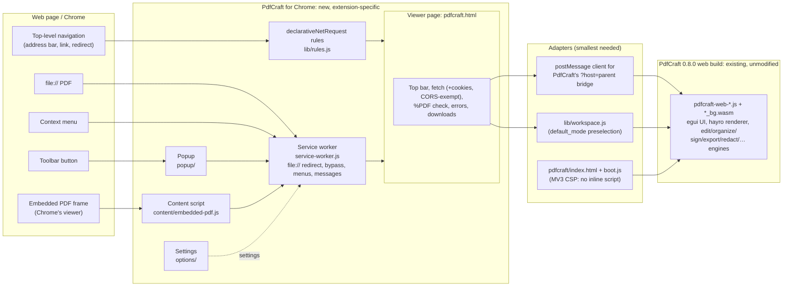

The same in plain text:

```
 web page / Chrome                    PdfCraft for Chrome (new)                     PdfCraft (existing, unmodified)
 ─────────────────                    ──────────────────────────                    ───────────────────────────────
 PDF navigation ──► DNR redirect rule ──┐
 file:// PDF ─────► service worker ─────┤
 context menu ────► service worker ─────┼──► pdfcraft.html ──(same-origin iframe)──► pdfcraft/index.html + boot.js
 toolbar ─────────► popup ──► sw ───────┤      fetch + checks + top bar                    └► pdfcraft-web-*.js / *_bg.wasm
 embedded PDF ────► content script ─────┘      postMessage: ready/open/save/dirty            (rendering, editing, signing,
                                               workspace preselection (localStorage)          export, organize, …)
 No server, no account, no network beyond fetching the PDF the user opened.
```

- **Existing:** the whole PDF engine and workbench (PdfCraft's official `pdfcraft-web-0.8.0.zip`,
  SHA-256 checked, files bundled byte-for-byte).
- **Adapters:** `boot.js`, the trunk loader moved out of an inline script; the viewer's
  client for PdfCraft's documented host bridge; `lib/workspace.js`.
- **New:** everything Chrome-specific.
- **No backend:** nothing needs one.

## 4. Browser security constraints that shaped the design

| Constraint | Consequence |
|---|---|
| `mime_types_handler` and `chrome.mimeHandler` are restricted to allowlisted extension IDs (Adobe, Chrome's own viewer) | PdfCraft redirects instead: a DNR rule on the response's Content-Type. The tab's own request completes headers first, so the viewer downloads the PDF a second time |
| Manifest V3 CSP: no inline scripts, no remote code; WebAssembly needs `'wasm-unsafe-eval'` | `script-src 'self' 'wasm-unsafe-eval'`; PdfCraft's inline loader moved to `pdfcraft/boot.js`; everything is bundled |
| DNR redirects to extension pages need the page in `web_accessible_resources` | `pdfcraft.html` is web-accessible, so other sites could frame it: the viewer refuses to run when framed (`window.top !== window`), and the CSP adds `frame-ancestors 'self'` |
| Extension pages can't read `file://` with `fetch()`, and only with the user's "Allow access to file URLs" | XHR for file URLs; Settings explains the switch; "Select a file" and drag-and-drop need no permission |
| Popups close when they lose focus (a file chooser takes focus) | "Select a file" opens the viewer's chooser page in a tab |
| An extension can't draw over Chrome's built-in PDF viewer from outside its frame | The embedded button is drawn by a content script inside the PDF frame (Adobe's technique) |
| PdfCraft's bridge only answers a parent window on its own origin | PdfCraft runs in an iframe of the extension's own viewer page, never inside a web page |
| Cross-origin fetches | Extension pages with host permissions are exempt from CORS, so the viewer can fetch any PDF the tab could load, with the user's cookies (`credentials: 'include'`) |
| A tab's URL is hidden from extension code without host access (including `chrome-extension://` pages) | The popup asks a PdfCraft viewer tab for its document by runtime message |

Permissions: `declarativeNetRequestWithHostAccess`, `webNavigation`, `contextMenus`, `downloads`,
`storage`, `scripting` and `activeTab` (the popup lists a page's PDFs). Host access is
`<all_urls>`, needed to redirect and fetch PDFs on any site. Adobe additionally requests `tabs`,
`nativeMessaging`, `webRequest`, `cookies`, `identity`, `sidePanel`, `offscreen`, `alarms` and
`fileSystem`; PdfCraft needs none of those.

## 5. UI comparison (Adobe reference ↔ PdfCraft implementation)

All PdfCraft screenshots come from `scripts/capture-screenshots.mjs` (Playwright, Chromium 139,
the built extension, local fixtures). The Adobe reference screenshots (taken signed out, PW/CDP
unless marked REA) are part of the private investigation notes and are not published here.

| | PdfCraft |
|---|---|
| Popup on a web page | 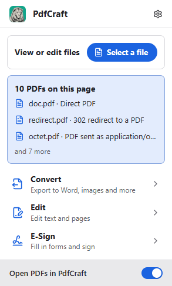 |
| Popup on a PDF tab | 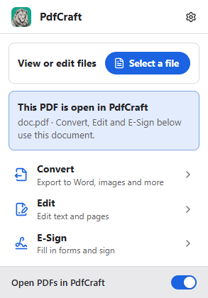 |
| Viewer | 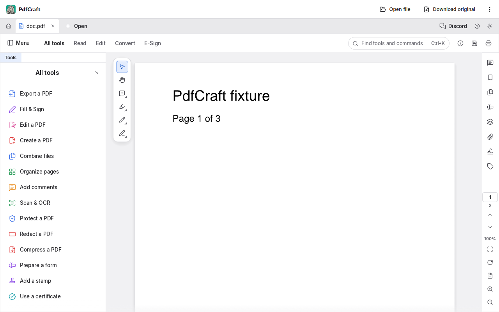 |
| Viewer menu | 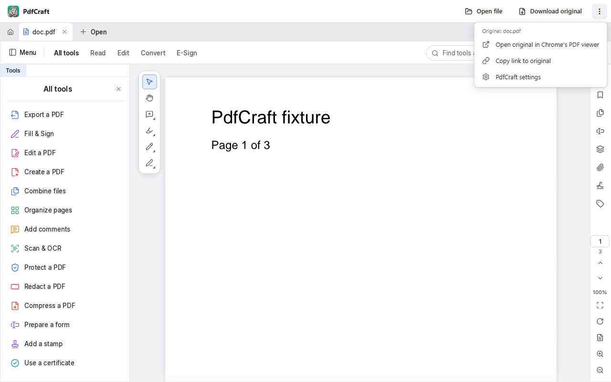 |
| Convert workspace | 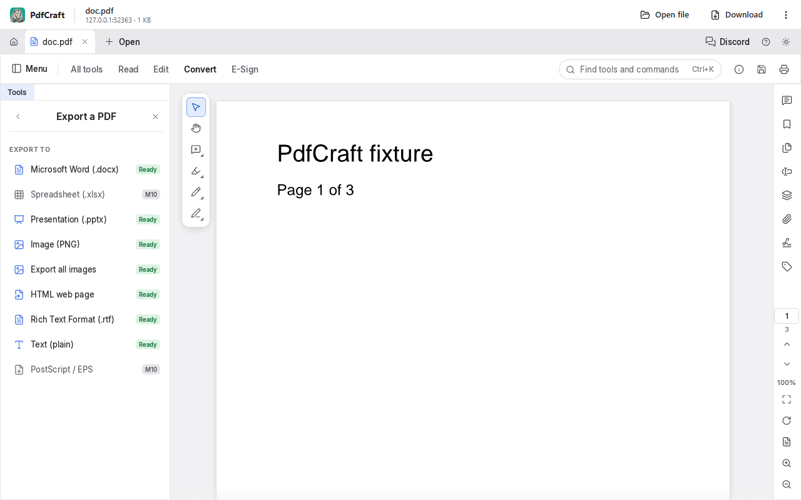 |
| E-Sign workspace | 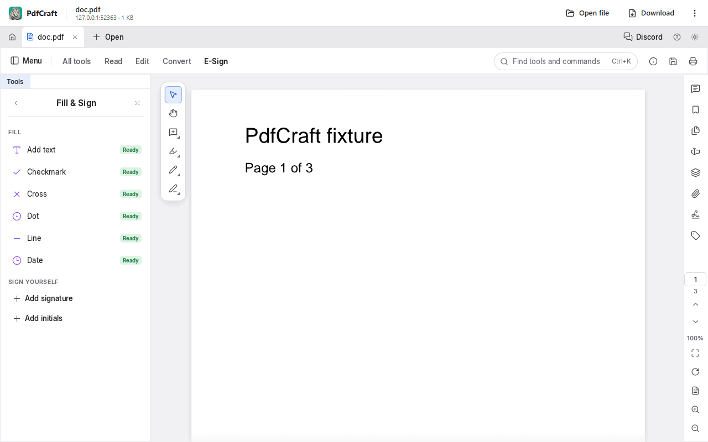 |
| Embedded PDF button | 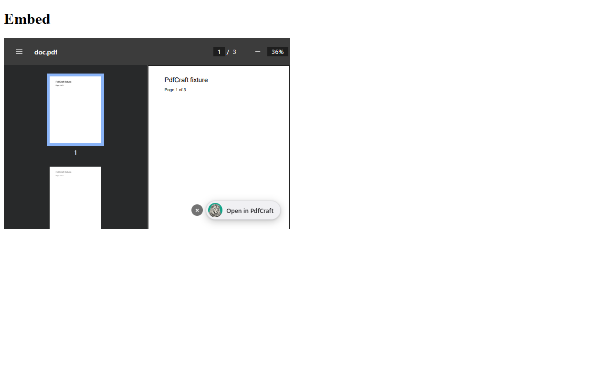 |
| Malformed PDF | 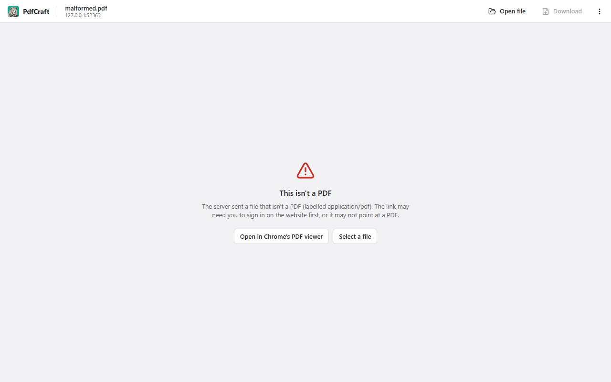 |
| Offline | 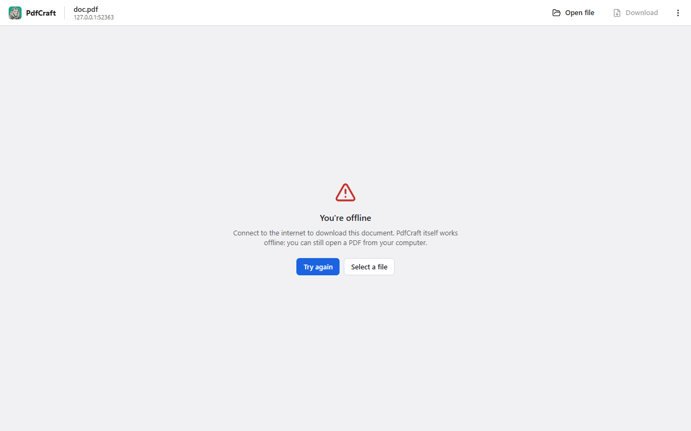 |
| "Select a file" | 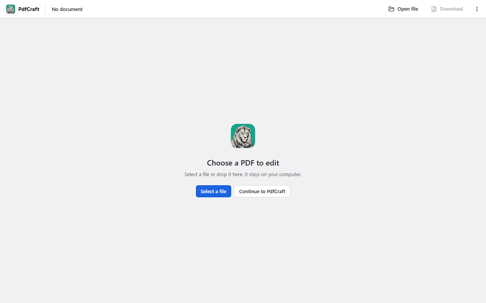 |

### Layout and behaviour differences

- **Popup:**
  - The structure is the same: 293 px wide, header, "View or edit files" card with a pill button,
    context card, then three rows.
  - PdfCraft's rows act directly; Adobe's are accordions of tool names.
  - The context card is local information (this tab's PDF, PDFs on the page) instead of Adobe's
    cloud promotions.
  - Colours, type (Inter / system UI), icons (Lucide) and the blue accent are PdfCraft's own
    (`crates/ui-egui/src/theme.rs`); no Adobe asset is used.
  - Measured 293 × 487 px, against Adobe's 293 × 496 px.
- **Viewer:**
  - Adobe's single top bar combines the brand and the workspace tabs. PdfCraft keeps its app UI
    intact under a slim extension bar that holds what only the extension can do: download the
    original, open in Chrome's viewer, copy link, settings.
  - Workspace tabs, the tools panel, the quick-tools bar and the page rail are PdfCraft's own and
    sit where Acrobat's are.
- **Embedded button:** same placement and behaviour (bottom right, inside Chrome's viewer frame,
  opens a new tab); PdfCraft's icon, plus a hide control on hover.
- **Errors:** Adobe falls back to Chrome's viewer or shows nothing. PdfCraft explains the problem
  and offers Try again / Open in Chrome's PDF viewer / Select a file.

## 6. Evidence index

| ID | Finding | Class | Evidence (type → reference) | Reproduce | Confidence / limits | Implication |
|---|---|---|---|---|---|---|
| E0 | The official extension is "Adobe Acrobat: PDF edit, convert, sign tools" by Adobe, Inc., ID `efaidnbmnnnibpcajpcglclefindmkaj`, version 26.10.1.0 (updated 2026-10-12, about 344M users). This is the same ID and version as the copy installed in this machine's Chrome profile, which was investigated | VF | Chrome Web Store listing `chromewebstore.google.com/detail/…/efaidnbmnnnibpcajpcglclefindmkaj` (fetched 2026-10-15); Adobe Help ["Enable Adobe Acrobat extension for Google Chrome"](https://helpx.adobe.com/acrobat/using/enable-createpdf-extension-chrome.html) and ["Adobe Acrobat Chrome extension"](https://helpx.adobe.com/acrobat/kb/get-acrobat-reader-extension-for-chrome-a.html) (install from the Web Store; "Allow access to file URLs" for local PDFs) | Open the listing; compare with `manifest.json` `version` and the profile's extension folder name | High | The investigated artifact is the genuine, current release |
| E1 | REA 6.4.0 connected; browser and JS tools available; `recover_javascript_sources` missing | VF | REA `binary_session` (01) | Call `binary_session` | High | REA usable for static analysis and HTTP(S) pages |
| E2 | REA can't see `chrome-extension://` targets | VF | REA `list_browser_targets` on Adobe (04: `ev_6a3437bd…`) and on PdfCraft (`ev_b96c9803…`: `unsupported_url: 2`) | `node tests/e2e/hold.mjs` then `list_browser_targets` on `http://127.0.0.1:9555` | High | Extension UI evidence comes from PW/CDP, labelled as such |
| E3 | Adobe takes over top-level PDF navigations | VF | A1 | 04 §1 steps | High | PdfCraft does the same with DNR |
| E4 | Adobe's viewer and popup are remote | VF | A5 | 04 key finding | High | Equivalent functionality must be local: PdfCraft bundles everything |
| E5 | Adobe's toolbar opens the side panel by default | SI | A8 | 04 §5 | Medium: no physical click possible | PdfCraft uses the popup, as the brief asks |
| E6 | Embedded button technique (inside the PDF frame) | VF | A7; REA `ev_886dff6a…` | 04 §4 | High | Reproduced; REA `ev_22cbf35e…` shows `PDFCRAFT-EMBEDDED-BUTTON` inside the `doc.pdf` frame of the fixture page |
| E7 | PdfCraft's web build exposes `?file`, `?host=parent` (+`?author`) only; no renderer flags; ~38 MB wasm; no eval, workers or extra fetches | VF | Source `apps/pdfcraft-web/src/main.rs`, release glue (02 §6) | Read the file | High | Bridge plus iframe is the integration; no rebuild needed |
| E8 | The bridge works in the released 0.8.0 build (`pdfcraft:open` is handled although its literal isn't greppable in the wasm) | VF | e2e "a direct PDF link opens…", screenshot `pdfcraft-00-spike-direct-pdf.png` | `npm run test:e2e` | High | |
| E9 | PdfCraft persists settings in `localStorage['pdfcraft']` as JSON with `default_mode`, `theme` ("Light") | VF | Runtime probe (key dump after 35 s); `capture-screenshots.mjs` log | Run the capture script | High | Workspace preselection and theme matching use it |
| E10 | PdfCraft Save (Ctrl+S) produces a valid PDF through the bridge | VF | e2e test plus `pdfcraft-cli info` oracle (3 pages, no warnings) | `npm run test:e2e` with PdfCraft installed | High | |

Unknowns that remain: Adobe's physical toolbar-click behaviour (A17); whether stable Chrome
honours Adobe's `mime_types_handler` (A2); Adobe's real-network offline behaviour; PdfCraft
printing and cookie-protected PDFs in the extension (manual tests, see [../testing.md](../testing.md)).
